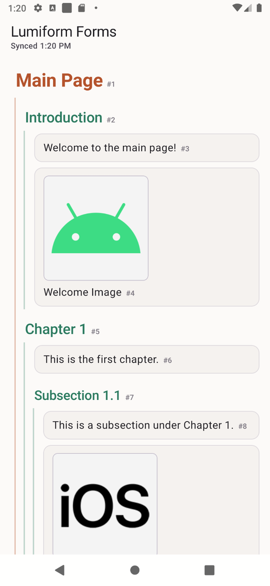
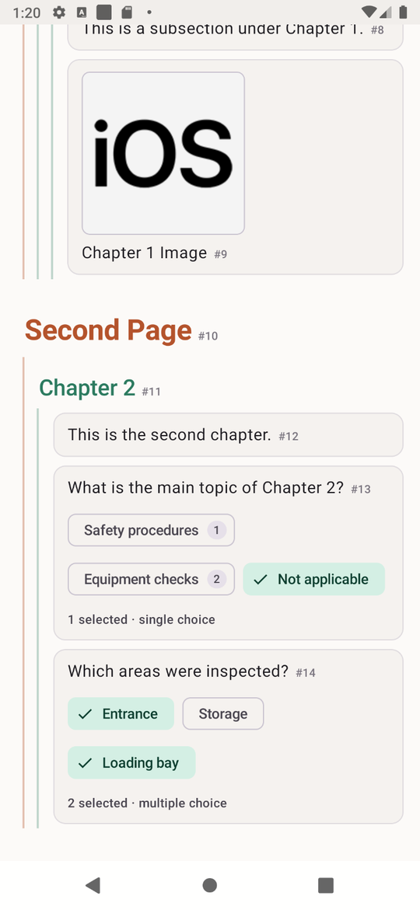
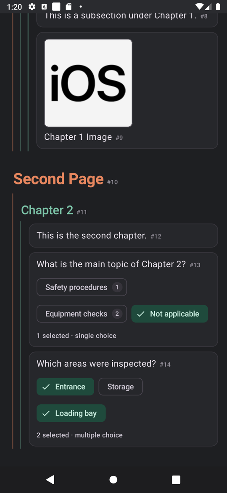
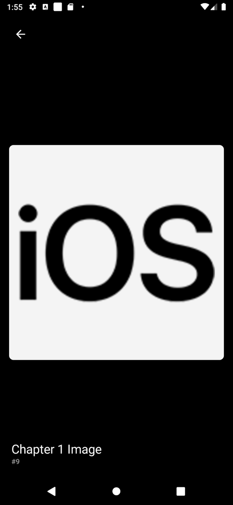
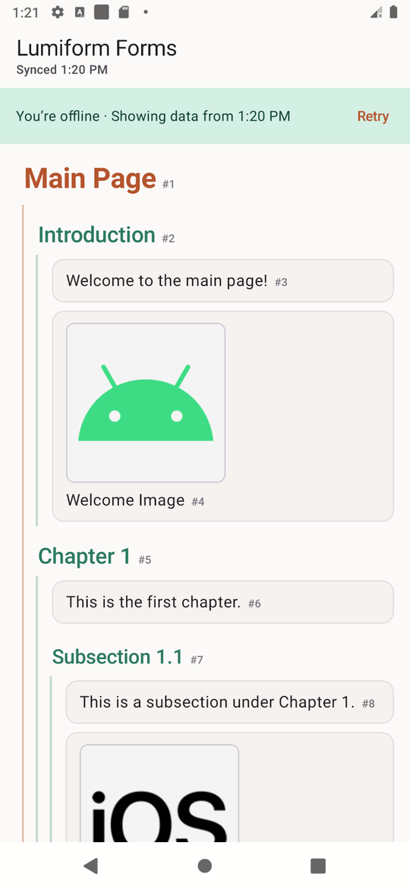
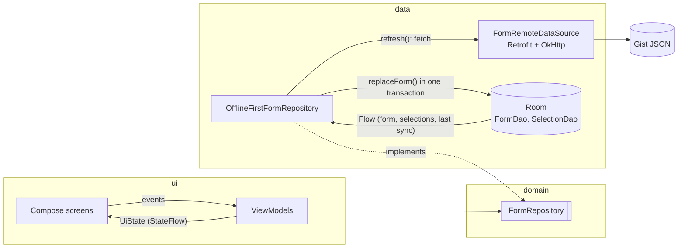

# Lumiform Forms: Android code challenge

[](https://github.com/DavidIbrahim/lumiform-android-challenge/actions/workflows/ci.yml)

A native Android app that loads a form from a JSON endpoint and shows its hierarchy: pages, sections nested to any depth, and text, image and choice questions. The app works offline and handles poor connections.

Built with Kotlin, Jetpack Compose, Material 3, Hilt, Retrofit, OkHttp, kotlinx.serialization, Room, Coil 3, type-safe Navigation Compose, and Coroutines with Flow.

| Form | Choice questions | Dark theme | Image viewer | Offline |
|---|---|---|---|---|
|  |  |  |  |  |

## Contents
- [Running it](#running-it)
- [What it does](#what-it-does)
- [Architecture](#architecture)
- [Key decisions and trade-offs](#key-decisions-and-trade-offs)
- [Offline and error handling](#offline-and-error-handling)
- [Testing](#testing)
- [Assumptions](#assumptions)
- [What I'd do with more time](#what-id-do-with-more-time)
- [Use of AI tools](#use-of-ai-tools)

## Running it

You need:
- **Android Studio** recent enough for AGP 9.2.
- **JDK 17 or newer** to start Gradle. Gradle downloads JDK 21 for its own daemon if you don't have it (`gradle/gradle-daemon-jvm.properties`).
- **Android SDK platform 37**, the compileSdk. Android Studio offers to install it; on the command line, run `sdkmanager "platforms;android-37.0"`.

```bash
./gradlew installDebug
```

```bash
./gradlew testDebugUnitTest
```

```bash
./gradlew lintDebug testDebugUnitTest assembleDebug
```

The last command is what CI runs on every push and pull request.

`minSdk` is 26 and `targetSdk` is 36. Libraries such as core-ktx 1.19 need `compileSdk` 37, but `compileSdk` only decides which APIs the code compiles against. `targetSdk` is what opts the app into new runtime behaviour, so it stays on the latest stable level on purpose.

## What it does

| Requirement | How |
|---|---|
| Show the page → section → question hierarchy | The tree is flattened into one list of rows, each with a depth. Rows are indented, with one guide line per ancestor: orange for the page, green for sections. |
| Font size follows the hierarchy | Page 28sp > section 22, 20, 18sp (smaller with each nesting level, never below 18sp) > question 16sp. Sizes come from the Material type scale, so they follow the user's font scale. |
| Text questions | Shown on a card with their text. |
| Image questions | A 160dp thumbnail. Tapping it grows the thumbnail into a full-screen, immersive viewer (a shared-element transition) with the title as a caption. Tap to hide or show the controls; pinch or double-tap to zoom; swipe down to close. |
| Choice questions | One chip per response, with its score. Single choice behaves like radio buttons, multiple choice like checkboxes. A status line shows how many are selected. Selections are saved in Room. |
| Offline | Room is the single source of truth. The last form and its selections show with no connection, and images already seen come from Coil's disk cache. |
| Bonus: poor connections | Connect, read and whole-request timeouts, retry with backoff for transient errors, ETag revalidation, an offline banner over cached data, and an automatic retry when the connection comes back. |

Each item also shows its `#id`, as in the brief's sample screenshot. Item types the app doesn't know yet appear as "not supported" instead of crashing.

## Architecture

The app is offline-first: the UI only ever reads from the database, and the network only writes to it.



```
com.davidsalama.lumiform
├── domain/          Plain Kotlin: FormNode tree, ResponseSet.toggle(), FormRepository, DataError
├── data/
│   ├── remote/      Retrofit API, DTOs, polymorphic serializer
│   ├── local/       Room entities, DAOs, database
│   ├── mapper/      DTO → domain → entities → domain
│   ├── network/     ConnectivityObserver (default-network callback)
│   └── OfflineFirstFormRepository, retryWithBackoff, error mapping
├── ui/
│   ├── form/        FormViewModel, flattenForm(), FormScreen, one composable per row type
│   ├── image/       Full-screen viewer, ZoomState, SwipeToDismiss
│   ├── navigation/  Type-safe routes
│   └── theme/       Colours, HierarchyTypography
└── di/              Hilt modules
```

It's a single `:app` module, organised by layer. At this size, splitting into modules would cost more in build setup than it gives back. The package boundaries are where the modules would go later (see [more time](#what-id-do-with-more-time)).

## Key decisions and trade-offs

### Storing a tree in a relational database: adjacency list
Room is required. Every node is one row in `form_node`, which points to its parent with `parent_id` and keeps its order with `position`.

| Table | Purpose |
|---|---|
| `form_node` | `id`, `parent_id` (FK → `form_node`, cascade), `position`, `type`, plus nullable per-type columns (`title`, `content`, `src`, `multiple_selection`, …) |
| `choice_response` | Responses for each choice question (FK → `form_node`, cascade) |
| `selected_response` | The user's answers: (`question_id`, `response_id`), with **no FK** |
| `sync_metadata` | When the last successful refresh happened |

The whole form is read with one query and rebuilt in memory in O(n) using `groupBy(parentId)`. Alternatives I considered:
- **One table per node type:** children would be spread across several tables, so restoring their order needs a merge. `parent_id` can't have a real foreign key because the parent's type varies. Every new type needs a migration.
- **The JSON as one text column:** that isn't relational, and answers can't reference questions.
- **Closure table or materialised path:** these only pay off for subtree queries, and this app always loads the whole form.

### Refresh is delete-all, then plain `@Insert`, in one transaction
A refresh deletes the server-owned tables, inserts the new form, deletes selections whose response no longer exists, and records the sync time, all in one `@Transaction`. If anything fails, the old form stays.

I avoided `OnConflictStrategy.REPLACE` on purpose. In SQLite, REPLACE deletes the existing row and inserts a new one, which fires `ON DELETE CASCADE` and silently wipes child rows. That's also why `selected_response` has no foreign key: a refresh deletes and re-inserts every question, so a cascade would erase the user's answers on every sync. Orphaned selections are cleaned up explicitly instead.

For large forms the next step would be to upsert what the server sent and delete only the ids that disappeared. Then a real foreign key on selections would be safe.

### One flat `LazyColumn`, not recursive composables
`flattenForm()` turns the tree into a `List<FormRow>`, where each row knows its depth. The screen renders it in one `LazyColumn` with stable keys (`id`) and a `contentType` per row type. Nested lazy lists can't be composed lazily, and a recursive `Column` would compose the whole form at once. A flat list stays lazy at any size, and `flattenForm()` is a pure function that is easy to test.

### Parsing: polymorphic, and tolerant of new types
The `type` field selects the DTO through a `JsonContentPolymorphicSerializer`. An unknown type becomes `UnknownNodeDto` instead of an exception, so a new type on the server doesn't break the app. Two quirks of the real response are handled:
- The gist serves `content-type: text/plain`, so the converter is registered for `application/json` and doesn't depend on the header.
- `score` can be a number, `null`, or missing (`Int? = null`).

### Choice selection
`ResponseSet.toggle(current, tapped)` is a pure, unit-tested function:
- In a multiple choice, a tap adds or removes that response.
- In a single choice, a tap replaces the current selection.
- Tapping the selected response again clears it, so a mis-tap can always be undone back to "no answer".

Selections are written to Room, and the screen redraws from the database, so what you see is what's stored. Toggles go through a mutex, so two fast taps can't overwrite each other.

### HTTP caching: always revalidate with the ETag
The gist sends `Cache-Control: max-age=300` and an `ETag`. The API request adds `Cache-Control: max-age=0`, so OkHttp always asks the server, but with `If-None-Match`. An unchanged form costs a `304` with no body. I didn't use `no-cache`, because OkHttp then skips the cache entirely and a `304` turns into an error; a MockWebServer test caught this. I also didn't trust the server's 5 minutes, because then an offline refresh would "succeed" from the HTTP cache and record a false sync time.

### Navigation passes ids, not data
The image viewer gets only the image's id and reads the image from Room. It works offline and after process death, and the route never carries a URL.

### Image viewer: immersive, and the thumbnail becomes the image
The thumbnail and the viewer's image share a key in a `SharedTransitionLayout` around the `NavHost`, so the picture you tapped grows into place and shrinks back on close. The thumbnail's decoded bitmap is kept in Coil's memory cache under its own key, and the viewer shows it immediately while the full image loads, so the transition never lands on an empty frame.

Gestures are decided once per touch, after the finger moves past touch slop: two fingers zoom and pan, and a mostly vertical one-finger drag of an unzoomed image is a swipe to close. That way swipe-to-close never fights with panning a zoomed image, and taps under the slop still reach the tap detector. The rules (`ZoomState`, `SwipeToDismiss`) are pure functions with their own tests.

### Fixed colour scheme
Dynamic (wallpaper) colour is off, because the page and section colours carry meaning and must look the same on every device. The image viewer is always dark, like a photo viewer, and hides the system bars along with its own controls. Images sit on a light canvas, because the sample's iOS logo is black on a transparent background and would disappear on a dark surface.

## Offline and error handling

| Situation | What the user sees |
|---|---|
| First launch, loading | Full-screen progress |
| First launch, request fails, nothing cached | A full-screen state for that error (offline, timeout, server error, invalid data): a small animated illustration drawn in Compose (Wi-Fi arcs searching for a signal when offline), a headline, what to do, and **Try again**. Offline, it also says the form will load by itself once the connection is back, which it does. |
| Cached form, refresh fails | The form stays usable, with a banner such as "You're offline · Showing data from 10:42" and **Retry**. Screen readers announce it politely. |
| Cached form, refreshing | Content stays; pull-to-refresh indicator; the top bar says "Syncing…" |
| Connection comes back | The app refreshes automatically, but only on an offline → online change, not when it starts |
| Form unchanged on the server | A `304`: nothing is downloaded or rewritten |
| Unknown item type | A "not supported" row; the rest of the form renders |
| Image fails to load | A broken-image placeholder |

Retries: up to 3 attempts, waiting 1 s and then 2 s, only for errors that may fix themselves (no connection, timeout, 5xx, 408, 429). A 404 or a body that can't be parsed fails immediately. Cancellation is never swallowed. Timeouts are 10 s to connect and 15 s per read, plus 30 s for the whole form request: a connection that trickles a few bytes at a time never trips the read timeout, so without that limit the form could stay loading forever.

## Testing

**137 tests**, all on the JVM; Robolectric runs the Room and Compose tests without an emulator. CI runs them on every push.

| Layer | What's covered | How |
|---|---|---|
| Parsing | The **real response** as a fixture, unknown types, missing or `null` scores, empty items | kotlinx.serialization |
| Network | A JSON body served as `text/plain`, a 500, a malformed body, ETag → `304` served from the cache | MockWebServer + a real OkHttp cache |
| Mappers | DTO → domain → entities → domain keeps order and nesting | Plain JUnit |
| Database | The form reads back as the same tree; a refresh replaces everything or, on failure, rolls back; selections survive a refresh unless their response was removed or moved | In-memory Room |
| Repository | Success writes the form; failure keeps the cache and returns a typed error; retries; selections | Real in-memory Room, fake network |
| Bad network, end to end | A server that goes silent, a download that trickles, a connection that drops mid-body, a 503 that recovers, a 404, an unreachable host: each gives the right result, retries only when it should, and keeps the cached form | MockWebServer → production OkHttp and Retrofit setup → repository → in-memory Room |
| Connectivity | The real observer starts online or offline correctly, ignores a network behind a login page, follows validation and loss, and unregisters when nobody listens | Robolectric's `ConnectivityManager` |
| Logic | `flattenForm`, `toggle`, typography by depth, retry/backoff, error mapping, sync-time formatting, zoom and swipe-to-close maths | Pure functions |
| ViewModels | Loading → content, errors with and without a cache, toggles, auto-retry on reconnect | Turbine, fake repository, `MainDispatcherRule` |
| UI | Banner vs full-screen error, chip roles and selection, image viewer states and tap-to-toggle controls | Compose UI tests |
| Whole app, fake data | Real activity, navigation, ViewModels and Hilt, with only the data layer swapped: open an image and come back; answers reach the repository | `@HiltAndroidTest` + `@UninstallModules` |
| Whole app, real data | Screen to database with only the server faked: first launch downloads and shows the form; answers are saved and survive rotation and reopening the app; reopening with the server down shows the cache, the answers and the offline banner; no cache shows the full-screen error and Try again recovers; the form loads by itself when the connection returns; rotating keeps the open image | `@HiltAndroidTest`, MockWebServer, in-memory Room |

I use fakes rather than mocks. The network is faked because it is slow and unpredictable. SQLite is used for real, because an in-memory database is cheap, and a fake DAO would mean re-implementing the transaction and orphan-cleanup SQL, which would test the fake rather than the app. Coil is replaced with a fake image engine so UI tests never hit the network.

## Assumptions

- Ids are unique across all node types, so `id` is the primary key.
- The endpoint returns one form document, and each refresh replaces it completely.
- Answers are stored on the device only; the brief has no endpoint to send them to.
- A response that disappears from the server takes its selection with it. Responses that stay keep their selections.

## What I'd do with more time

- **Modules:** `:core:model`, `:core:network`, `:core:database`, `:core:designsystem`, `:feature:form`, `:feature:image`. This gives faster incremental builds and enforced boundaries; the packages are already split this way.
- **Sending answers:** an outbox table plus WorkManager with network constraints, to upload selections once a backend exists.
- **Incremental sync:** upsert plus delete-missing, which would allow a real FK + cascade on selections.
- **Image prefetch:** after each refresh, download every image into Coil's disk cache, so thumbnails not seen yet also work offline.
- **Long forms:** collapsible sections (the flat list makes this a filter in `flattenForm()`), and paging if forms become very large.
- **Screenshot tests** (Roborazzi or Paparazzi) to catch visual regressions in rows and themes.
- **An accessibility audit** with TalkBack and Switch Access on real devices; the semantics are in place but haven't been audited.
- **Sharing code with iOS:** move `data/` and `domain/` to Kotlin Multiplatform and swap Retrofit for Ktor with the OkHttp engine. The DTOs and serializers would stay as they are.

## Use of AI tools

The brief allows AI tools, so I'll say how I used one. I built this with Claude Code (Anthropic) as a pair programmer: to discuss the design, write code and tests from those decisions, and check the app on an emulator. I made the design decisions, reviewed every change before it was committed, and can explain each one. That's why commits don't carry an AI co-author line; this section says it instead.
